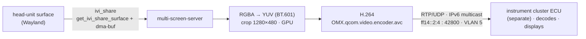
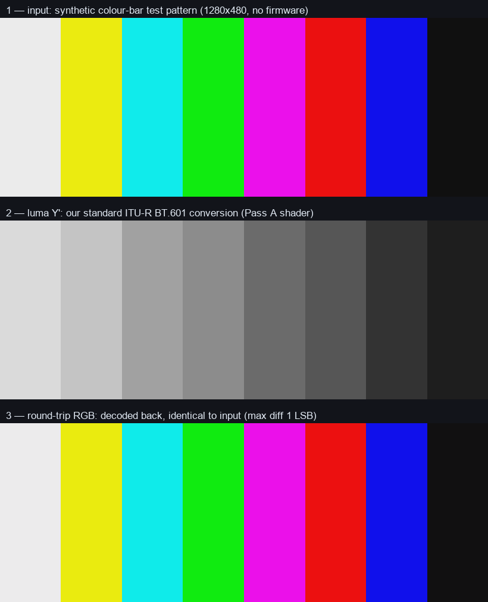
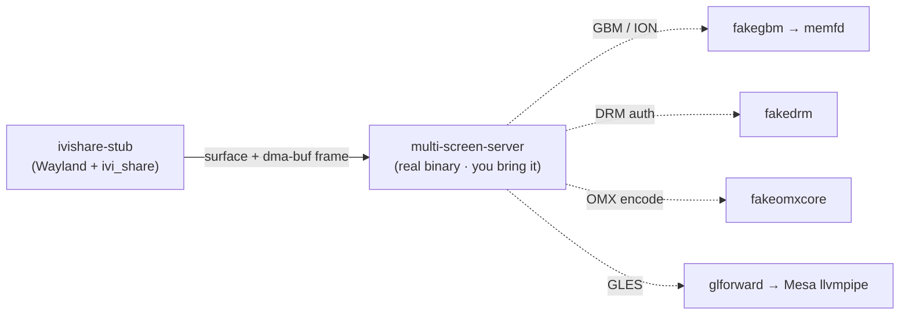

# moi3-cluster-pipeline-re

> Reverse engineering of the **VW Group MIB3 "MOI3" (LG)** head-unit → instrument-cluster **video pipeline**, reproduced on a PC workbench — how a rendered surface (the native map, or any app) reaches the digital cockpit.


---

**TL;DR** — On MOI3 LG the head unit renders a surface; a service called `multi-screen-server` grabs it via the Wayland **`ivi_share`** extension, converts RGBA→YUV and crops it to **1280×480** on the GPU, encodes it to **H.264** (`OMX.qcom.video.encoder.avc`), and sends it as **RTP/UDP IPv6 multicast** (`ff14::2:4`, port 42800) that the separate cluster ECU decodes. This repo **reverse-engineers that pipeline and reproduces it on an ordinary PC** — Mesa software GL plus shims standing in for the Qualcomm GPU/encoder — so the mechanism can be studied and driven end-to-end **without a car and without shipping any firmware**.

It is a **lab notebook and a working bench harness**, not a product and not an on-car tool. The *display* mechanism is reproduced here; obtaining code execution on a real unit is **out of scope** (see below).

## 📡 The pipeline



Full state-machine RE — including how the server picks its source surface from the RSI `DisplayManagement` model (`surfaceid://`) — in **[docs/shareserver-pipeline.md](docs/shareserver-pipeline.md)**; the `ivi_share` protocol in **[docs/ivi-share-protocol.md](docs/ivi-share-protocol.md)**; the risk-first milestone plan in **[docs/design.md](docs/design.md)**.

## ✅ Does it convert? (bench result)

The head unit's RGBA→cluster conversion is the **standard ITU-R BT.601** (studio-swing) matrix — an RE finding. `spike/moi3_shader_demo.c` implements that standard conversion in our own GLSL and runs it on Mesa software GL (no GPU, no firmware). On a synthetic colour-bar frame the encode→decode round-trip is **identical to the input** (max **1 LSB**), confirming the conversion end-to-end:



## 🚀 Getting started

The repo ships a `Dockerfile` with just the toolchain (a C compiler + Mesa software GL). No firmware is included.

**Self-contained demo** — the RGBA→YCbCr (BT.601) conversion, no firmware needed:

```sh
docker build -t moi3-bench .
docker run --rm -v "$PWD":/poc moi3-bench sh -c '\
  gcc -O2 -o /tmp/demo spike/moi3_shader_demo.c -lEGL -lGLESv2 && \
  /tmp/demo frame.ppm encoder.glsl /tmp/y.bin /tmp/nv12.bin'
```

(`frame.ppm` is any P6 RGBA frame; `encoder.glsl` is the head unit's NV12-packing shader, which you supply — see below.)

**Full `multi-screen-server` bench** — runs the real binary against the shims. This one is **bring-your-own**: supply your own extracted firmware sysroot and the glforward base, then:

```sh
FW=/path/to/your/sysroot GLF=/path/to/glforward sh spike/run.sh
```

See [`spike/run.sh`](spike/run.sh) for the mount layout. The container runs `--network none`; nothing here is written to a vehicle.

### How the bench stands in for the car



## 📂 Layout

| Path | What it is |
|---|---|
| `shims/` | LD_PRELOAD stand-ins for the Qualcomm stack the binary expects — `fakegbm` (GBM/ION in `memfd`), `fakedrm` (DRM auth), `fakeomxcore` (OMX IL encoder) |
| `compositor/` | `ivishare-stub` — a minimal Wayland compositor exposing the `ivi_share` extension the binary binds |
| `glforward-ext/` | a GL-forwarding layer so the binary's GLES runs on Mesa `llvmpipe` (no GPU) |
| `spike/` | bench harnesses — Mesa capability probes and `moi3_shader_demo.c` (runs the RGBA→NV12 conversion on a real frame) |
| `tools/` | RE helpers — a Wayland-protocol extractor and Ghidra decompilation scripts |
| `docs/` | the reverse-engineering write-ups |

## 🧪 What you bring yourself

- **No proprietary firmware is included — and never will be.** The VW/LG binaries (`multi-screen-server`, the LG `.so`s, the sysroot, the encoder shader) are **not** in this repository. You extract your own, from a unit or firmware you are entitled to analyse, and point the harness at them.
- **The color conversion here is our own.** `moi3_shader_demo.c` implements the **standard ITU-R BT.601** studio-swing matrix — the same standard conversion the head unit performs (an RE finding). We reproduce the public standard, not their source. The full encoder (NV12-packing) shader is **not** included; the harness loads it from a file you supply.

## 🔒 Scope — what this is NOT

- **Not a way around the unit's protections.** MOI3 LG enforces Qualcomm Secure Boot, dm-verity, VW firmware signing and SMACK. This project documents and reproduces the **display pipeline**; it does **not** provide, and does **not** require, any way to defeat those. The on-unit **code-execution / access** method is **out of scope**.
- **Not an on-car tool.** Everything runs in a throwaway container on a PC. Nothing here was ever written to a vehicle.

## 🔬 Companion research

Prose research notes on the whole platform — architecture, firmware structure, the coding model, the cluster-map pipeline and the three "layers" of map-on-cluster — live in the companion repo:

**→ [lipedesign/mib3-moi3-lg-research](https://github.com/lipedesign/mib3-moi3-lg-research)**

That repo is the *what*; this one is the *how*, reproduced on a bench.

## 🤝 Contributing & security

See [CONTRIBUTING.md](CONTRIBUTING.md) for how to help (and the no-firmware / no-bypass ground rules), and [SECURITY.md](SECURITY.md) to report a vulnerability.

## ⚖️ Disclaimer

Independent research. Not affiliated with, authorized by, or endorsed by Volkswagen AG, Audi AG or LG Electronics. "MIB", "MQB" and "Active Info Display" are used descriptively. Provided as-is, with no warranty. Analysing or modifying a vehicle's modules can affect safety, warranty and regulatory compliance — **act at your own risk.**

## 📄 License

Code: **MIT** · Documentation (`.md` files): **CC BY 4.0** — see [LICENSE](LICENSE). Attribution: *lipedesign — MOI3 Cluster Pipeline RE*.
