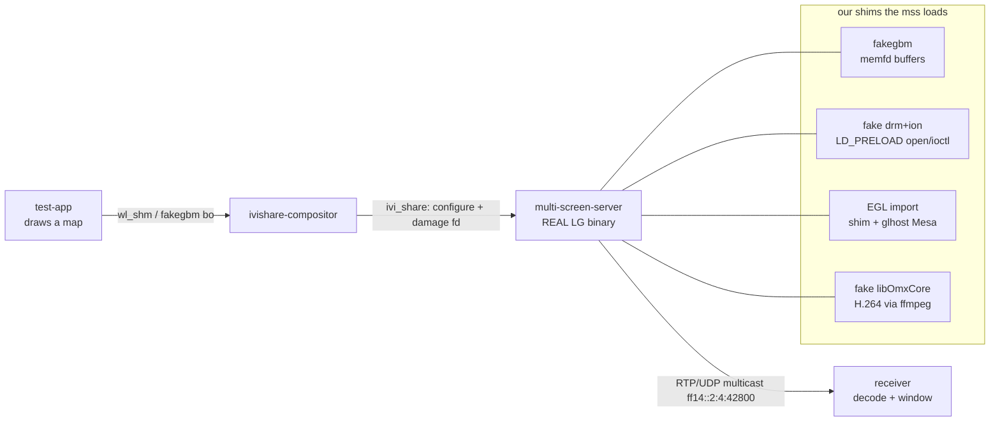

# Design — running the real MOI3 cluster-map pipeline on a workbench

> **Status: proposed (spec for review).** This is the design for the full PoC. It builds on the
> spike findings ([ivi-share-protocol.md](ivi-share-protocol.md) and the notes below). Nothing
> here is built yet beyond the compositor and the spike harness.

## 1. Goal and scope

Demonstrate, on a PC/container workbench, the **real** MOI3 LG head-unit → cluster map-video
pipeline end to end, **pixel to pixel**: a test application draws a frame, the **real LG
`multi-screen-server` binary** picks it up, encodes it and sends it as the same RTP/UDP IPv6
multicast the cluster consumes, and a receiver decodes and displays it.

**In scope:** reproducing the *display* pipeline with the real producer binary, by emulating the
Qualcomm graphics stack it depends on. **Out of scope and deliberately not built:** anything that
runs this on a vehicle, obtains code execution on a real unit, or defeats Secure Boot / dm-verity
/ VW signing / SMACK. Nothing here is written to a car. Performance and production robustness are
non-goals; "one frame visibly crosses the whole real pipeline" is success.

## 2. Background (what the spike established)

The real `multi-screen-server` (`mss`) does, in order:

`ivi_share` (grab a surface by id) → **EGLImage** from its buffer → `Rgba2yuv` GLES3 shader
(RGBA→YUV + crop to 1280×480) → **`OMX.qcom.video.encoder.avc`** (H.264) → `TransportStream`
RTP/UDP **multicast** (`ff14::2:4`, port 42800).

The spike ([painel-de-instrumentos notes](../../referencia/ferramentas/mib3-sandbox/painel-de-instrumentos.md),
15/10/2026) resolved the `ivi_share` protocol and got the `mss` past "ivi_share not supported".
It then **blocks in the Qualcomm GBM init** (`msmgbm` → `/dev/dri/card0`, `/dev/ion`), before it
asks for the shared surface. The OrbStack kernel offers no `/dev/dri`, `udmabuf` or `vkms`, and
the GBM is the Qualcomm `msm_gbm` (KGSL-specific), so a generic DRM device would not help either.

**Dependency surface recovered from the binary** (what the shims must cover):

- `NEEDED`: `libgbm.so`, `libdrm.so.2`, `libOmxCore.so`, `libEGL_adreno.so`, `libGLESv2_adreno.so`,
  `libwayland-client`, `libwaylandegl`, `libPoco{Foundation,Net,JSON}`, `librsic`, `libtraceif`.
- GBM (9): `gbm_create_device`, `gbm_device_destroy`, `gbm_bo_create`, `gbm_bo_import`,
  `gbm_bo_destroy`, `gbm_bo_get_fd`, `gbm_bo_get_height`, `gbm_bo_get_stride`, `gbm_perform`.
- EGL: `eglGetPlatformDisplayEXT`, `eglCreateImageKHR`, `eglDestroyImageKHR`,
  `glEGLImageTargetTexture2DOES`, `GL_OES_EGL_image_external_essl3`.
- OMX IL: `OMX_Init`, `OMX_GetHandle("OMX.qcom.video.encoder.avc")`, `OMX_FreeHandle`, `OMX_Deinit`,
  states Idle/Executing, `OMX_IndexParamPortDefinition`.
- The `mss` also calls `libdrm` directly (`DRM_IOCTL_GET_MAGIC`/`AUTH_MAGIC` seen in strace).

## 3. Approach

The `mss` binary runs unmodified; everything it links to that needs the Qualcomm SoC is replaced
by **our own cooperating shims** (the same trick the sandbox already uses for OpenGL via the
`fakegl` forwarder). Because we own *both* the producer side (test app + compositor) and the
consumer side (the shims the `mss` loads), the buffer never has to be a real dma-buf — our GBM
hands out `memfd`-backed buffers and our EGL imports them by uploading their pixels into Mesa.

## 4. Components

Each is a small, independently testable unit with one job.

| # | Component | Job | Interface it must honour | Status |
|---|-----------|-----|--------------------------|--------|
| 4.1 | `compositor/ivishare-stub.c` | map `surface_id` → producer buffer; emit `configure` + `damage(fd)` | `ivi_share` protocol | partial (no `damage` yet) |
| 4.2 | `test-app` | create an `ivi_surface`, draw a "map" into a buffer, register its id | `ivi_application` + our buffer | new |
| 4.3 | `fakegbm` (`libgbm.so`) | the 9 `gbm_*`; a `bo` is a `memfd` with w/h/stride/fd | GBM ABI the `mss` uses | new |
| 4.4 | `fake-drm-ion` (LD_PRELOAD) | make `open("/dev/dri/card0")`/`/dev/ion` return our fds; answer the few ioctls (DRM auth, PRIME, ION alloc) | libc `open`/`openat`/`ioctl`/`close` | new |
| 4.5 | EGL import (extend `glforward` shim + `glhost`) | `eglGetPlatformDisplayEXT`, `eglCreateImageKHR` from our bo, `glEGLImageTargetTexture2DOES` = upload bo pixels into a Mesa texture | EGL 1.4 + image_external | new (on top of existing fakegl) |
| 4.6 | `fake-omxcore` (`libOmxCore.so`) | OMX IL core + `OMX.qcom.video.encoder.avc` component; feed input YUV, emit H.264 (ffmpeg/x264 inside) | OMX IL (the subset the `mss` drives) | new |
| 4.7 | RSI params | give the `mss` its `streamParameters` (surface id, port, w, h) via `/displaymanagement/streamParameters` | reuse `stubs/rsi-mockup` + `rsi-display-management` | reuse |
| 4.8 | `receiver` | subscribe `ff14::2:4:42800`, de-RTP, decode H.264, show | the multicast the `mss` emits | new (ffmpeg; reuse `janela/` to display) |

## 5. Build order (risk-first)

Each milestone has an observable pass/fail, built on the isolated spike harness (`spike/`).

- **M1 — buffer layer comes up.** fakegbm (4.3) + fake-drm-ion (4.4): the `mss` gets past
  `gbm_create_device` and reaches `ivi_share.get_ivi_share_surface`. *Pass:* the compositor logs
  `get_ivi_share_surface`.
- **M2 — EGLImage import (the riskiest elo, prove it early).** 4.5: the `mss` turns our bo into an
  EGLImage and binds it to a texture. *Pass:* no `failed to create EGLImageKHR`, and the texture
  reads back the test pattern in `glhost`.
- **M3 — colour convert.** The stock `Rgba2yuv` GLES3 shader runs in `glhost` (Mesa) and yields a
  correct NV12/YUV of the test pattern. *Pass:* dumped YUV matches.
- **M4 — encode.** fake-omxcore (4.6): the `mss` produces an H.264 bitstream from the YUV.
  *Pass:* the saved bitstream decodes to the test pattern offline.
- **M5 — transport.** The `mss`'s own `TransportStream` sends the multicast; the receiver (4.8)
  decodes and shows. *Pass:* receiver window shows the test pattern.
- **M6 — real producer + end to end.** test-app (4.2) draws an actual moving map; full chain runs.
  *Pass:* the map is visible in the receiver window, pixel to pixel through the real `mss`.

M1 and M2 are the ones that decide the project; if M2 can't be made to work in Mesa software, we
revisit (fallback: the "shorter route" consumer, kept as a documented option).

## 6. Error handling & observability

- Everything runs in the throwaway container (`--privileged --network none`), isolated from the
  HMI, driven by `spike/`-style scripts; nothing touches a vehicle.
- Each stage dumps its artifact for offline check: the imported texture (PPM), the YUV, the H.264
  (`.264`), the received frames (PPM). Logs: compositor, `glhost`, `[omx_encoder]`, strace of the
  `mss` (open/ioctl/mmap/recvmsg).
- Shims fail loud: every unimplemented `gbm_*`/`OMX_*`/ioctl logs once with its arguments, so the
  next gap is always named.

## 7. Testing

Follows the sandbox's existing test style (`driver/tests`, `glforward-moi3/tests`): small C/host
programs, run in the container.

- **fakegbm:** create/import a bo, write via mmap, read the fd back, check w/h/stride.
- **fake-omxcore:** feed a known YUV, decode the emitted H.264, compare to source (allowing codec
  loss) — standalone, no `mss`.
- **receiver:** feed a known RTP/H.264 multicast, assert the decoded PPM.
- **EGL import:** a tiny GLES client that imports a known bo and reads the texture back.
- Integration: the M1–M6 pass criteria above are the integration tests.

## 8. Open risks

1. **EGLImage import in Mesa llvmpipe (M2).** No real dma-buf, so import is by pixel upload, not
   zero-copy. If the `mss` assumes a specific image target or modifier, we adapt the shim. This is
   the load-bearing unknown.
2. **`gbm_perform` and the direct `libdrm` ioctls.** Variadic/undocumented; the exact calls the
   `mss` makes are discovered by running under strace and filling gaps iteratively.
3. **OMX IL subset + colour format.** Only the `mss`'s path is implemented; NV12 layout and buffer
   alignment must match what the shader produces and the encoder expects.
4. **Where the `mss` gets `surface_id`.** Likely RSI `streamParameters`; may require bringing up
   `rsi-display-management` (4.7). Confirmed at M1.

## 9. Scope / protection note

This reproduces the **display** pipeline with the real producer by emulating the SoC graphics
stack around it. It does not provide, require, or document any way to obtain code execution on a
real unit or to defeat Secure Boot / dm-verity / VW signing / SMACK. No proprietary firmware is
redistributed: the `multi-screen-server` and the LG libraries are supplied by the operator from
their own unit; this repository ships only our shims and harness.
